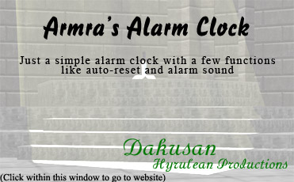
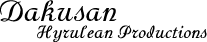

<div>
Original Post: <a href="https://www.castledragmire.com/Posts/Project_About_Pages">Project About Pages</a><br>
Date: 2008-05-26<br>
Tags: 2D Rendering, Compression, Design, Formats, Programming hacks, Thought Process<br><br>

<table width="700"><tr><td><a href="AboutWindow-Concept.zip"></a>
<p>I’ve been thinking for a while that I need to add “about windows” to the executables of all my applications with GUIs. So I first made a test design [left, <a href="AboutWindow-Concept.zip">psd file attached</a>]</p>
<p>Unfortunately, this requires at least 25KB for the background alone, and this is larger than many of my project executables themselves. This is a problem for me, as I like keeping executables small and simple.</p>
</td></tr></table>

<table width="730"><tr><td>
I therefore decided to scratch the background and just go with normal “about windows” and my signature in a spiffy font [<a href="BlizzardD%20[B025000D].TTF">BlizzardD</a>]: <font size="-1">(white background added by web browser for visibility)</font>
</td></tr></table>

The above PNG signature is only 1.66KB, so “yay”, right?  Wrong 🙁, it quickly occurred to me that XP does not natively support PNG.<br><br>

<table width="730"><tr><td>My next though is “what about a GIF?” (GIF is the predecessor to PNG, also lossless): (1.82KB)</td></tr></table>

I remembered that GIF files worked for VB, so I thought that native Windows’ API <i>might</i> support it too without adding in extra DLLs, but alas, I was wrong. This at least <i>partially</i> solves the problem for me in Visual Basic, but not fully, as GIF does not support translucency, but only 1 color of transparency, so the picture would look horribly aliased (pixilated).<br><br>

The final solution I decided on is having a small translucency-mask and alpha-blending it and the primary signature color (RGB(6,121,6)) to the “about windows’ ” background.<br>
<table width="730"><tr><td>Since alpha-blending/translucency is an 8 bit value, a gray-scale (also 8 bits per pixel) image is perfect for a translucency mask format for VB: (1.82KB, GIF)</td></tr></table>
You may note that this GIF is the exact same size as the previous GIF, which makes sense as it is essentially the exact same picture, just with swapped color palettes.<br><br>

The final hurdle is how to import the picture into C with as little space wasted as possible.  The solution to this is to create an easily decompressable alpha-mask (alpha means translucency).<br>
<table width="730"><tr><td> I started with the bitmap mask: (25.6KB, BMP)</td></tr></table>
From there, I figured there would be 2 easy formats for compression that would take very little code to decompress:
<ul>
	<li>Number of Transparent Pixels, Number of Foreground Pixels in a Row, List of Foreground Pixel Masks, REPEAT... (This is a form of “<a href="http://en.wikipedia.org/wiki/Run-length_encoding">Run-length encoding</a>”)</li>
	<li>Start the whole image off as transparent, and then list each group of foreground pixels with: X Start Coordinate, Y Start Coordinate, Number of Pixels in a Row, List of Foreground Pixel Masks</li>
</ul>
It also helped that there were only 16 different alpha-masks, not including the fully transparent mask, so each alpha-mask could be fit within half a byte (4 bits).  I only did the first option because I’m pretty sure the second one would be larger because it would take more bits for an x/y location than for a transparent run length number.
<p>Other variants could be used too, like counting the background as a normal mask index and just do straight run length encoding with indexes, but I knew this would make the file much larger for 2 reasons: this would add a 17th alpha-mask which would push index sizes up to 5 bits, and background run lengths are much longer (in this case 6 bits), so all runs would need to be longer (non-background runs are only 3 bits in this case). Anyways, it ended up creating a <b>1,652</b> byte <a href="AboutWindow-Output.bin">file</a> 🙂.</p><br>

<p>This could also very easily be edited to input/output 8-bit indexed bitmaps, or full color bitmaps even (with a max of 256 colors, or as many as you wanted with a few more code modifications). If one wanted to use this for normal pictures with a solid background instead of an alpha-mask, just know the words “Transparent” means “Background” and “Translucent” means “Non-Background” in the code.</p>
<p>GIF and PNG file formats actually use similar techniques, but including the code for their decoders would cause a lot more code bloat than I wanted, especially since they [theoretically] include many more compression techniques than just run-length encoding.  Programming for specific cases will [theoretically] <b>always</b> be smaller and faster than programming for general cases.  On a side note, from past research I’ve done on the JPEG format, along with programming my <a href=https://www.castledragmire.com/Projects/Hynes>NES Emulator, Hynes</a>, they [JPEG &amp; NES] share the same main graphical compression technique [grouping colors into blocks and only recording color variations].</p><br>

The following is the code to create the compressed alpha-mask stream: [<a href="MaskCompress.c">Direct link to C file with <b>all</b> of the following code blocks</a>]


</div>

```c
//** Double stars denotes changes for custom circumstance [The About Window Mask]
#include <windows.h>
#include <stdio.h>
#include <conio.h>

//Our encoding functions
int ErrorOut(char* Error, FILE* HandleToClose); //If an error occurs, output
UINT Encode(UCHAR* Input, UCHAR* Output, UINT Width, UINT Height); //Encoding process
UCHAR NumBitsRequired(UINT Num); //Tests how many bits are required to represent a number
void WriteToBits(UCHAR* StartPointer, UINT BitStart, UINT Value); //Write Value to Bit# BitStart after StartPointer - Assumes more than 8 bits are never written

//Program constants
const UCHAR BytesPerPixel=3, TranspMask=255; //24 bits per pixel, and white = transparent background color

//Encoding file header
typedef struct
{
	USHORT DataSize; //Data size in bits - **Should be UINT
	UCHAR Width, Height; //**Should be USHORTs
	UCHAR TranspSize, TranslSize; //Largest number of bits required for a run length for Transp[arent] and Transl[ucent]
	UCHAR NumIndexes, Indexes[0]; //Number and list of indexes
} EncodedFileHeader;

int main()
{
	UCHAR *InputBuffer, *OutputBuffer; //Where we will hold our input and output data
	FILE *File; //Handle to current input or output file
	UINT FileSize; //Holds input and output file sizes

	//The bitmap headers tell us about its contents
	BITMAPFILEHEADER BitmapFileHead;
	BITMAPINFOHEADER BitmapHead;

	//Read in bitmap header and confirm file type
	File=fopen("AboutWindow-Mask.bmp", "rb"); //Normally you'd read in the filename from passed arguments (argv)
	if(!File) //Confirm file open
		return ErrorOut("Cannot open file for reading", NULL);
	fread(&BitmapFileHead, sizeof(BITMAPFILEHEADER), 1, File);
	if(BitmapFileHead.bfType!=*(WORD*)"BM" || BitmapFileHead.bfReserved1 || BitmapFileHead.bfReserved2) //Confirm we are opening a bitmap
		return ErrorOut("Not a bitmap", File);

	//Read in the rest of the data
	fread(&BitmapHead, sizeof(BITMAPINFOHEADER), 1, File);
	if(BitmapHead.biPlanes!=1 || BitmapHead.biBitCount!=24 || BitmapHead.biCompression!=BI_RGB) //Confirm bitmap type - this code would probably have been simpler if I did an 8 bit indexed file instead... oh well, NBD.  **It has also been programmed for easy transition to 8 bit indexed files via the "BytesPerPixel" constant.
		return ErrorOut("Bitmap must be in 24 bit RGB format", File);
	FileSize=BitmapFileHead.bfSize-sizeof(BITMAPINFOHEADER)-sizeof(BITMAPFILEHEADER); //Size of the data portion
	InputBuffer=malloc(FileSize);
	fread(InputBuffer, FileSize, 1, File);
	fclose(File);

	//Run Encode
	OutputBuffer=malloc(FileSize); //We should only ever need at most FileSize space for output (output should always be smaller)
	memset(OutputBuffer, 0, FileSize); //Needs to be zeroed out due to how writing of data file is non sequential
	FileSize=Encode(InputBuffer, OutputBuffer, BitmapHead.biWidth, BitmapHead.biHeight); //Encode the file and get the output size

	//Write encoded data out
	File=fopen("Output.msk", "wb");
	fwrite(OutputBuffer, FileSize, 1, File);
	fclose(File);
	printf("File %d written with %d bytes\n", 1, FileSize);

	//Free up memory and wait for user input
	free(InputBuffer);
	free(OutputBuffer);
	getch(); //Pause for user input
	return 0;
}

int ErrorOut(char* Error, FILE* HandleToClose) //If an error occurs, output
{
	if(HandleToClose)
		fclose(HandleToClose);
	printf("%s\n", Error);
	getch(); //Pause for user input
	return 1;
}

UINT Encode(UCHAR* Input, UCHAR* Output, UINT Width, UINT Height) //Encoding process
{
	UCHAR Indexes[256], NumIndexes, IndexSize, RowPad; //The index re-mappings, number of indexes, number of bits an index takes in output data, padding at input row ends for windows bitmaps
	USHORT TranspSize, TranslSize; //Largest number of bits required for a run length for Transp[arent] (zero) and Transl[ucent] (non zero) - should be UCHAR's, but these are used as explained under "CurTranspLen" below
	UINT BitSize, x, y, ByteOn, NumPixels; //Current output size in bits, x/y coordinate counters, current byte location in Input, number of pixels in mask

	//Calculate some stuff
	NumPixels=Width*Height; //Number of pixels in mask
	RowPad=4-(Width*BytesPerPixel%4); //Account for windows DWORD row padding - see declaration comment
	RowPad=(RowPad==4 ? 0 : RowPad);

	{ //Do a first pass to find number of different mask values, run lengths, and their encoded values
		const UCHAR UnusedIndex=255; //In our index list, unused indexes are marked with this constant
		USHORT CurTranspLen, CurTranslLen; //Keep track of the lengths of the current transparent & translucent runs - TranspSize and TranslSize are temporarily used to hold the maximum run lengths
		//Zero out all index references and counters
		memset(Indexes, UnusedIndex, 256);
		NumIndexes=0;
		TranspSize=TranslSize=CurTranspLen=CurTranslLen=0;
		//Start gathering data
		for(y=ByteOn=0;y<Height;y++) //Column
		{
			for(x=0;x<Width;x++,ByteOn+=BytesPerPixel) //Row
			{
				UCHAR CurMask=Input[ByteOn]; //Curent alpha mask
				if(CurMask!=TranspMask) //Translucent value?
				{
					//Determine if index has been used yet
					if(Indexes[CurMask]==UnusedIndex) //We only need to check 1 byte per pixel as they are all the same for gray-scale **This would need to change if using non 24-bit or non gray-scale
					{
						((EncodedFileHeader*)Output)->Indexes[NumIndexes]=CurMask; //Save mask number in the index header
						Indexes[CurMask]=NumIndexes++; //Save index number to the mask
					}

					//Length of current transparent run
					TranspSize=(CurTranspLen>TranspSize ? CurTranspLen : TranspSize); //Max(CurTranspLen, TranspSize)
					CurTranspLen=0;

					//Length of current translucent run
					CurTranslLen++;
				}
				else //Transparent value?
				{
					//Length of current translucent run
					TranslSize=(CurTranslLen>TranslSize ? CurTranslLen : TranslSize);  //Max(CurTranslLen, TranslSize)
					CurTranslLen=0;

					//Length of current transparent run
					CurTranspLen++;
				}
			}

			ByteOn+=RowPad; //Account for windows DWORD row padding
		}
		//Determine number of required bits per value
		printf("Number of Indexes: %d\nLongest Transparent Run: %d\nLongest Translucent Run: %d\n", NumIndexes,
			TranspSize=CurTranspLen>TranspSize ? CurTranspLen : TranspSize, //Max(CurTranspLen, TranspSize)
			TranslSize=CurTranslLen>TranslSize ? CurTranslLen : TranslSize  //Max(CurTranslLen, TranslSize)
			);
		IndexSize=NumBitsRequired(NumIndexes);
		TranspSize=NumBitsRequired(TranspSize); //**This is currently overwritten a few lines down
		TranslSize=NumBitsRequired(TranslSize); //**This is currently overwritten a few lines down
		printf("Bit Lengths of - Indexes, Trasparent Run Length, Translucent Run Length: %d, %d, %d\n", IndexSize, TranspSize, TranslSize);
	}

	//**Modify run sizes (custom) - this function could be run multiple times with different TranspSize and TranslSize until the best values are found - the best values would always be a weighted average
	TranspSize=6;
	TranslSize=3;

	//Start processing data
	BitSize=(sizeof(EncodedFileHeader)+NumIndexes)*8; //Skip the file+bitmap headers and measure in bits
	x=ByteOn=0;
	do
	{
		//Transparent run
		UINT CurRun=0;
		while(Input[ByteOn]==TranspMask && x<NumPixels && CurRun<(UINT)(1<<TranspSize)-1) //Final 2 checks are for EOF and capping run size to max bit length
		{
			x++;
			CurRun++;
			ByteOn+=BytesPerPixel;
			if(x%Width==0) //Account for windows DWORD row padding
				ByteOn+=RowPad;
		}
		WriteToBits(Output, BitSize, CurRun);
		BitSize+=TranspSize;

		//Translucent run
		CurRun=0;
		BitSize+=TranslSize; //Prepare to start writing masks first
		while(x<NumPixels && Input[ByteOn]!=TranspMask && CurRun<(UINT)(1<<TranslSize)-1) //Final 2 checks are for EOF and and capping run size to max bit length
		{
			WriteToBits(Output, BitSize+CurRun*IndexSize, Indexes[Input[ByteOn]]);
			x++;
			CurRun++;
			ByteOn+=BytesPerPixel;
			if(x%Width==0) //Account for windows DWORD row padding
				ByteOn+=RowPad;
		}
		WriteToBits(Output, BitSize-TranslSize, CurRun); //Write the mask before the indexes
		BitSize+=CurRun*IndexSize;
	} while(x<NumPixels);

	{ //Output header
		EncodedFileHeader *OutputHead;
		OutputHead=(EncodedFileHeader*)Output;
		OutputHead->DataSize=BitSize-(sizeof(EncodedFileHeader)+NumIndexes)*8; //Length of file in bits not including header
		OutputHead->Width=Width;
		OutputHead->Height=Height;
		OutputHead->TranspSize=(UCHAR)TranspSize;
		OutputHead->TranslSize=(UCHAR)TranslSize;
		OutputHead->NumIndexes=NumIndexes;
	}
	return BitSize/8+(BitSize%8 ? 1 : 0); //Return entire length of file in bytes
}

UCHAR NumBitsRequired(UINT Num) //Tests how many bits are required to represent a number
{
	UCHAR RetNum;
	_asm //Find the most significant bit
	{
		xor eax, eax //eax=0
		bsr eax, Num //Find most significant bit in eax
		mov RetNum, al
	}
	return RetNum+((UCHAR)(1<<RetNum)==Num ? 0 : 1); //Test if the most significant bit is the only one set, if not, at least 1 more bit is required
}

void WriteToBits(UCHAR* StartPointer, UINT BitStart, UINT Value) //Write Value to Bit# BitStart after StartPointer - Assumes more than 8 bits are never written
{
	*(WORD*)(&StartPointer[BitStart/8])|=Value<<(BitStart%8);
}
```

<div>
<br>

The code to decompress the alpha mask in C is as follows: (Shares some header information with above code)


</div>

```c
//Decode
void Decode(UCHAR* Input, UCHAR* Output); //Decoding process
UCHAR ReadBits(UCHAR* StartPointer, UINT BitStart, UCHAR BitSize); //Read value from Bit# BitStart after StartPointer - Assumes more than 8 bits are never read
UCHAR NumBitsRequired(UINT Num); //Tests how many bits are required to represent a number --In Encoding Code--

int main()
{
	//--Encoding Code--
		UCHAR *InputBuffer, *OutputBuffer; //Where we will hold our input and output data
		FILE *File; //Handle to current input or output file
		UINT FileSize; //Holds input and output file sizes
	
		//The bitmap headers tell us about its contents
		//Read in bitmap header and confirm file type
		//Read in the rest of the data
		//Run Encode
		//Write encoded data out
	//--END Encoding Code--

	//Run Decode
	UCHAR* O2=(BYTE*)malloc(BitmapFileHead.bfSize);
	Decode(OutputBuffer, O2);

/*	//If writing back out to a 24 bit windows bitmap, this adds the row padding back in
	File=fopen("output.bmp", "wb");
	fwrite(&BitmapFileHead, sizeof(BITMAPFILEHEADER), 1, File);
	fwrite(&BitmapHead, sizeof(BITMAPINFOHEADER), 1, File);
	fwrite(O2, BitmapFileHead.bfSize-sizeof(BITMAPINFOHEADER)-sizeof(BITMAPFILEHEADER), 1, File);*/

	//Free up memory and wait for user input --In Encoding Code--
	return 0;
}

//Decoding
void Decode(UCHAR* Input, UCHAR* Output) //Decoding process
{
	EncodedFileHeader H=*(EncodedFileHeader*)Input; //Save header locally so we have quick memory lookups
	UCHAR Indexes[256], IndexSize=NumBitsRequired(H.NumIndexes); //Save indexes locally so we have quick lookups, use 256 index array so we don't have to allocate memory
	UINT BitOn=0; //Bit we are currently on in reading
	memcpy(Indexes, ((EncodedFileHeader*)Input)->Indexes, 256); //Save the indexes
	Input+=(sizeof(EncodedFileHeader)+H.NumIndexes); //Start reading input past the header

	//Unroll/unencode all the pixels
	do
	{
		UINT i, l; //index counter, length (transparent and then index)
		//Transparent pixels
		memset(Output, TranspMask, l=ReadBits(Input, BitOn, H.TranspSize)*BytesPerPixel);
		Output+=l;

		//Translucent pixels
		l=ReadBits(Input, BitOn+=H.TranspSize, H.TranslSize);
		BitOn+=H.TranslSize;
		for(i=0;i<l;i++) //Write the gray scale out to the 3 pixels, this should technically be done in a for loop, which would unroll itself anyways, but this way ReadBits+index lookup is only done once - ** Would need to be in a for loop if not using gray-scale or 24 bit output
			Output[i*BytesPerPixel]=Output[i*BytesPerPixel+1]=Output[i*BytesPerPixel+2]=Indexes[ReadBits(Input, BitOn+i*IndexSize, IndexSize)];
		Output+=l*BytesPerPixel;
		BitOn+=l*IndexSize;
	} while(BitOn<H.DataSize);

/*	{ //If writing back out to a 24 bit windows bitmap, this adds the row padding back in
		UINT i;
		UCHAR RowPad=4-(H.Width*BytesPerPixel%4); //Account for windows DWORD row padding
		RowPad=(RowPad==4 ? 0 : RowPad);
		Output-=H.Width*H.Height*BytesPerPixel; //Restore original output pointer
		for(i=H.Height;i>0;i--) //Go backwards so data doesn't overwrite itself
			memcpy(Output+(H.Width*BytesPerPixel+RowPad)*i, Output+(H.Width*BytesPerPixel)*i, H.Width*BytesPerPixel);
	}*/
}

UCHAR ReadBits(UCHAR* StartPointer, UINT BitStart, UCHAR BitSize) //Read value from Bit# BitStart after StartPointer - Assumes more than 8 bits are never read
{
	return (*(WORD*)&StartPointer[BitStart/8]>>BitStart%8)&((1<<BitSize)-1);
}
```

<div>
<br>

Of course, I added some minor assembly and optimized the decoder code to get it from 335 to 266 bytes, which is only 69 bytes less 😕, but it’s something (measured using my <a href=https://www.castledragmire.com/Projects/Small>Small project</a>). There is no real reason to include it here, as it’s in many of my projects and the included <a href=MaskCompress.c>C file</a> for this post.<br><br>

And then some test code just for kicks...
</div>

```c
//Confirm Decoding
BOOL CheckDecode(UCHAR* Input1, UCHAR* Input2, UINT Width, UINT Height); //Confirm Decoding

//---- Put in main function above "//Free up memory and wait for user input" ----
printf(CheckDecode(InputBuffer, O2, BitmapHead.biWidth, BitmapHead.biHeight) ? "good" : "bad");

BOOL CheckDecode(UCHAR* Input1, UCHAR* Input2, UINT Width, UINT Height) //Confirm Decoding
{
	UINT x,y,i;
	UCHAR RowPad=4-(Width*BytesPerPixel%4); //Account for windows DWORD row padding
	RowPad=(RowPad==4 ? 0 : RowPad);

	for(y=0;y<Height;y++)
		for(x=0;x<Width;x++)
			for(i=0;i<BytesPerPixel;i++)
				if(Input1[y*(Width*BytesPerPixel+RowPad)+x*BytesPerPixel+i]!=Input2[y*(Width*BytesPerPixel)+x*BytesPerPixel+i])
					return FALSE;
	return TRUE;
}
```

<div>
<br>

From there, it just has to be loaded into a bit array for manipulation and set back a bitmap device context, and it’s done!<br>
VB Code: <font size="-1">(Add the signature GIF as a picture box where it is to show up and set its “Visible” property to “false” and “Appearance” to “flat”)</font>
</div>

```vb
'Swap in and out bits
Private Declare Function GetDIBits Lib "gdi32" (ByVal aHDC As Long, ByVal hBitmap As Long, ByVal nStartScan As Long, ByVal nNumScans As Long, lpBits As Any, lpBI As BITMAPINFOHEADER, ByVal wUsage As Long) As Long
Private Declare Function SetDIBitsToDevice Lib "gdi32" (ByVal hdc As Long, ByVal x As Long, ByVal y As Long, ByVal dx As Long, ByVal dy As Long, ByVal SrcX As Long, ByVal SrcY As Long, ByVal Scan As Long, ByVal NumScans As Long, Bits As Any, BitsInfo As BITMAPINFOHEADER, ByVal wUsage As Long) As Long
lpBits As Any, lpBitsInfo As BITMAPINFOHEADER, ByVal wUsage As Long, ByVal dwRop As Long) As Long
Private Type RGBQUAD
		b As Byte
		g As Byte
		r As Byte
		Reserved As Byte
End Type
Private Type BITMAPINFOHEADER '40 bytes
		biSize As Long
		biWidth As Long
		biHeight As Long
		biPlanes As Integer
		biBitCount As Integer
		biCompression As Long
		biSizeImage As Long
		biXPelsPerMeter As Long
		biYPelsPerMeter As Long
		biClrUsed As Long
		biClrImportant As Long
End Type
Private Const DIB_RGB_COLORS = 0 '  color table in RGBs

'Prepare colors
Private Declare Sub CopyMemory Lib "kernel32" Alias "RtlMoveMemory" (Destination As Any, Source As Any, ByVal Length As Long)
Private Declare Function GetBkColor Lib "gdi32" (ByVal hdc As Long) As Long

Public Sub DisplaySignature(ByRef TheForm As Form)
    'Read in Signature
    Dim BitmapLength As Long, OutBitmap() As RGBQUAD, BitInfo As BITMAPINFOHEADER, Signature As PictureBox
    Set Signature = TheForm.Signature
    BitmapLength = Signature.Width * Signature.Height
    ReDim OutBitmap(0 To BitmapLength - 1) As RGBQUAD
    With BitInfo
            .biSize = 40
            .biWidth = Signature.Width
            .biHeight = -Signature.Height
            .biPlanes = 1
            .biBitCount = 32
            .biCompression = 0 'BI_RGB
            .biSizeImage = .biWidth * 4 * -.biHeight
    End With
    GetDIBits Signature.hdc, Signature.Image, 0, Signature.Height, OutBitmap(0), BitInfo, DIB_RGB_COLORS
    
    'Alpha blend signature
    Dim i As Long, Alpha As Double, BackColor As RGBQUAD, ForeColor As RGBQUAD, OBC As Long, OFC As Long
    OFC = &H67906
    OBC = GetBkColor(TheForm.hdc)
    CopyMemory BackColor, OBC, 4
    CopyMemory ForeColor, OFC, 4
    For i = 0 To BitmapLength - 1
        Alpha = 1 - (CDbl(OutBitmap(i).r) / 255)
        OutBitmap(i).r = ForeColor.r * Alpha + BackColor.r * (1 - Alpha)
        OutBitmap(i).g = ForeColor.g * Alpha + BackColor.g * (1 - Alpha)
        OutBitmap(i).b = ForeColor.b * Alpha + BackColor.b * (1 - Alpha)
    Next i
    
    SetDIBitsToDevice TheForm.hdc, Signature.Left, Signature.Top, Signature.Width, Signature.Height, 0, 0, 0, Signature.Height, OutBitmap(0), BitInfo, DIB_RGB_COLORS
    TheForm.Refresh
End Sub
```

<div>
<br>
C Code
</div>

```c
//Prepare to decode signature
//const UCHAR BytesPerPixel=4, TranspMask=255; //32 bits per pixel (for quicker copies and such - variable not used due to changing BYTE*s to DWORD*s), and white=transparent background color - also not used anymore since we directly write in the background color
//Load data from executable
HGLOBAL GetData=LoadResource(NULL, FindResource(NULL, "DakSig", "Sig")); //Load the resource from the executable
BYTE *Input=(BYTE*)LockResource(GetData); //Get the resource data

//Prepare header and decoding data
UINT BitOn=0; //Bit we are currently on in reading
EncodedFileHeader H=*(EncodedFileHeader*)Input; //Save header locally so we have quick memory lookups
DWORD *Output=Signature=new DWORD[H.Width*H.Height]; //Allocate signature memory

//Prepare the index colors
DWORD Indexes[17], IndexSize=NumBitsRequired(H.NumIndexes); //Save full color indexes locally so we have quick lookups, use 17 index array so we don't have to allocate memory (since we already know how many there will be), #16=transparent color
DWORD BackgroundColor=GetSysColor(COLOR_BTNFACE), FontColor=0x067906;
BYTE *BGC=(BYTE*)&BackgroundColor, *FC=(BYTE*)&FontColor;
for(UINT i=0;i<16;i++) //Alpha blend the indexes
{
	float Alpha=((EncodedFileHeader*)Input)->Indexes[i] / 255.0f;
	BYTE IndexColor[4];
	for(int n=0;n<3;n++)
		IndexColor[n]=(BYTE)(BGC[n]*Alpha + FC[n]*(1-Alpha));
	//IndexColor[3]=0; //Don't really need to worry about the last byte as it is unused
	Indexes[i]=*(DWORD*)IndexColor;
}
Indexes[16]=BackgroundColor; //Translucent background = window background color

//Unroll/unencode all the pixels
Input+=(sizeof(EncodedFileHeader)+H.NumIndexes); //Start reading input past the header
do
{
	UINT l; //Length (transparent and then index)
	//Transparent pixels
	memsetd(Output, Indexes[16], l=ReadBits(Input, BitOn, H.TranspSize));
	Output+=l;

	//Translucent pixels
	l=ReadBits(Input, BitOn+=H.TranspSize, H.TranslSize);
	BitOn+=H.TranslSize;
	for(i=0;i<l;i++) //Write the gray scale out to the 3 pixels, this should technically be done in a for loop, which would unroll itself anyways, but this way ReadBits+index lookup is only done once - ** Would need to be in a for loop if not using gray-scale or 24 bit output
		Output[i]=Indexes[ReadBits(Input, BitOn+i*IndexSize, IndexSize)];
	Output+=l;
	BitOn+=l*IndexSize;
} while(BitOn<H.DataSize);

//Output the signature
const BITMAPINFOHEADER MyBitmapInfo={sizeof(BITMAPINFOHEADER), 207, 42, 1, 32, BI_RGB, 0, 0, 0, 0, 0};
SetDIBitsToDevice(MyDC, x, y, MyBitmapInfo.biWidth, MyBitmapInfo.biHeight, 0, 0, 0, MyBitmapInfo.biHeight, Signature, (BITMAPINFO*)&MyBitmapInfo, DIB_RGB_COLORS);
```

<div>
<br>

<p>This all adds ~3.5KB to each VB project, and ~2KB to each C/CPP project. Some other recent additions to all project executables include the <i>Hyrulean Productions</i> icon (~1KB) and file version information (1-2KB). I know that a few KB doesn’t seem like much, but when executables are often around 10KB, it can almost double their size.</p>
<p>While I’m on the topic of project sizes, I should note that I always compress their executables with <a href="http://upx.sourceforge.net/">UPX</a>, a very nifty executable compressor. It would often be more prudent to use my <a href=https://www.castledragmire.com/Projects/Small>Small project</a>, but I don’t want to complicate my open-source code.</p><br>

One other possible solution I did not pursue would be to take the original font and create a subset font of it with only the letters (and font size?) I need, and see if that file is smaller. I doubt it would have worked well though.</div>