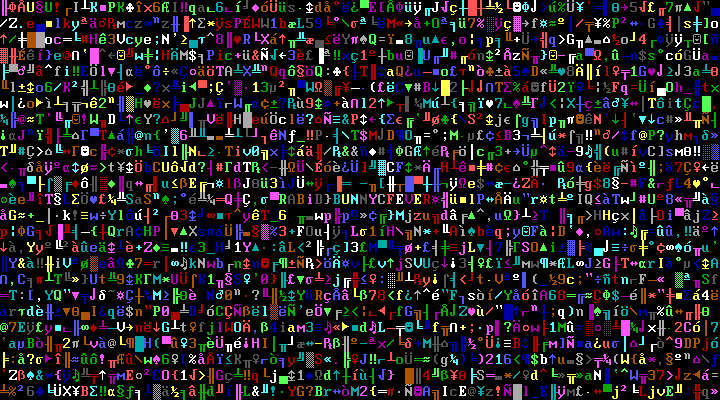

Original Post: <a href="https://www.castledragmire.com/Posts/My_New_Boot_Loader">My New Boot Loader</a> 
Date: 2009-10-25 
SubTitle: Hijack it at the beginning 
Tags: Boot Loader, Operating Systems, Security, TrueCrypt, Video Clips  

I have been a proponent and user of <a href="https://www.castledragmire.com/Posts/Truecrypt_5.0_tribulations">pre-boot authentication volume (hard drive) encryption</a> for quite a while now, but there is one security hole in it that always bugged me. This is the fact that the boot loader (the code at the beginning [sector 0] of the hard drive that starts the computer [usually loads the operating system]) is unencrypted itself and can be tampered with. Even though the encrypted data is completely safe from reading without a password, the password itself could be hijacked from someone modifying the boot loader and having it record your password when you type it. This hack could also be made hard to detect because the original boot loader could be restored from the hijacked one after the damage is done.

I decided this was a moot point for a long time, until I saw <a href="http://it.slashdot.org/story/09/10/23/1212248/Of-Encrypted-Hard-Drives-and-Evil-Maids?from=rss">it got slashdotted</a>. This prompted me to finally change my security model slightly so I was no longer vulnerable to this problem. The appropriate method is to always use a known secure <a href="http://www.truecrypt.org/docs/?s=rescue-disk">TrueCrypt rescue disk</a>, which contains its own boot loader, to boot the hard drive. Unfortunately, CDs are a bit cumbersome to always keep around. The workaround for me was to use a bootable <a href="http://en.wikipedia.org/wiki/USB_flash_drive">USB Flash Drive</a> instead, as I keep it on my keychain which is always with me. Getting the TrueCrypt boot loader to work from the flash drive was not easy at all due to how bootable flash drives work (they take the hard drive #0 slot in BIOS, which Windows doesn’t like). It took some <a href="https://gna.org/projects/grub4dos/">GRUB4DOS</a> magic to get things going, but it all ended up working out 🙂.

I removed the TrueCrypt boot loader from my hard drive so I would not be tempted to use it, and would always use the flash drive. This left the boring message of “Error loading operating system” upon booting without the flash drive, which I just couldn’t stand, so I decided to have some fun writing my own “Operating System Not Found” boot loader 🙂.
 
Video Notes:
<ul>
	<li>It’s a lot harder to spot the hidden text string from the video than from the actual thing x.x;</li>
	<li>The boot loader was ran through a <a href="http://en.wikipedia.org/wiki/Virtual_machine">virtual machine</a> (<a href="http://www.vmware.com/">VMWare</a>) so I could easily record it.</li>
</ul>

Here is the <a href="Boot.asm">code for the boot loader</a> (in assembly), and here is the <a href="Boot.raw">compiled boot loader</a> which can be placed in the boot sector of any bootable medium (Hard Drive, USB Flash, CD, etc).
 
<b>Warning</b>:

<b>Do not attempt to replace the boot loader on your hard drive without knowing what you are doing, as this is a very dangerous operation that can make your computer unbootable. Always back up your boot loader before making modifications to it so you can easily restore it. Also, when writing a boot loader, do not overwrite bytes 0x1BE-0x1FD of your boot sector as they contain important partition information.</b>
  

Useful Wikipedia references: <a href="http://en.wikipedia.org/wiki/INT_10">INT 10 (BIOS interrupt call for video services)</a>, <a href="http://en.wikipedia.org/wiki/BIOS_Color_Attributes">BIOS Color Attributes</a>  

This post is continued at: <a href="../2009-10-31 - BIOS Level Key Logger">BIOS Level Key Logger</a>

