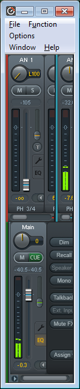

<div>
Original Post: <a href="https://www.castledragmire.com/Posts/Babyface_Pro_Volume_Modification_via_Mousewheel">Babyface Pro Volume Modification via Mousewheel</a><br>
Date: 2019-04-09<br>
Tags: Audio, AutoHotKey, Babyface, Examples, TotalMix, Windows<br><br>

<p>Part of my workstation’s audio setup uses the <a href="http://babyface.rme-audio.de/">RME Babyface Pro</a>. Until the most recent update of their software, the built-in Window’s sound’s master volume for the device was ignored. So while this script isn’t as important as before, I still find it very useful. So the following is an <a href="https://www.autohotkey.com/">AutoHotkey</a> script which modifies the master volume in the TotalMix FX window via the mousewheel (when alt+ctrl is held down). This expects the TotalMix FX window to be sized as small as it can, and to have a channel selected for the control room’s Main Out. It should look like this:</p>
<br><br>
The script is as follows:<br>
</div>

```ahk
;Function to create lparam/wparam for SendMessage
CalculatePARAM(w1, w2)
{
	IfLess, w1, 0
		w1 := 65535 + w1 + 1
	IfLess, w2, 0
		w2 := 65535 + w2 + 1

	return (w2<<16 | w1)
}

;Send a mouse wheel action to a window
SendMouseWheel(WindowHWND, Steps, XPos, YPos)
{
	;Constants
	WM_MOUSEWHEEL := 0x20A
	WheelStepAmount := 120

	;Calculate and execute the message
	WinGetPos, ScreenX, ScreenY,,, ahk_id %WindowHWND%
	wparam := CalculatePARAM(0, Steps*WheelStepAmount)
	lparam := CalculatePARAM(XPos+ScreenX, YPos+ScreenY)
	SendMessage, %WM_MOUSEWHEEL%, %wparam%, %lparam%,, ahk_id %WindowHWND%
}

^!WheelUp::
ControlGet, ControlHWND, Hwnd,,AfxFrameOrView100s1,RME TotalMix
if ControlHWND
	SendMouseWheel(ControlHWND, 1, 36, 428)
return

^!WheelDown::
ControlGet, ControlHWND, Hwnd,,AfxFrameOrView100s1,RME TotalMix
if ControlHWND
	SendMouseWheel(ControlHWND, -1, 36, 428)
return
```